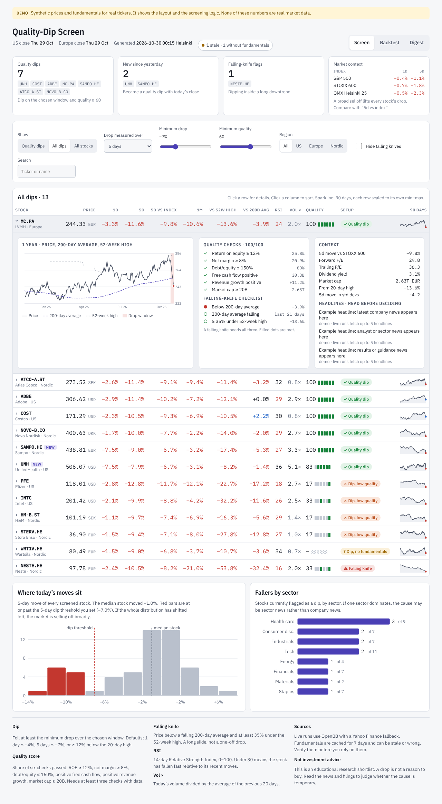

# Daily quality-dip screen (long-only research tool, US + Europe)

## What this project shows

- A research workflow that reports its own negative result: the dip rule was event-tested out of sample and showed no edge the sample could separate from noise, and the volatility forecast failed calibration and is not wired in.
- Backtest hygiene: pre-registered feature experiments with a log of every variant tried, and a data snapshot with an executed EDA notebook.
- A nightly pipeline for US and European large caps that writes a dashboard, a digest and trigger alerts, plus about 390 tests and a no-network demo (`python -m dipdash --demo`).

License: MIT, see `LICENSE`.

Screens US and European large caps every night after the close for sharp price drops in otherwise high-quality companies, and writes a dashboard,
a digest and trigger alerts. **Educational research only: it never gives investment advice.** Wording in all output: "screen results", "candidates",
"flagged because ...", "a condition became true".

- **Rules for any contributor or agent:** read `CLAUDE.md` first (plan before code, honest backtests, dashboard checks, wording).
- **Cloud / multi-agent setup:** `docs/CLOUD.md`.
- **Plan, decisions, research:** `docs/PLAN.md`, `docs/decisions.md`, `docs/research-report.md`.
- **Latest data snapshot with an executed EDA notebook:** `snapshots/2026-11-04/` (see its `README.md`, `DATA_DICTIONARY.md`).
- **Run (Windows):** `scripts\run_daily.bat` (see `START_HERE.md`). **Demo, no network:** `python -m dipdash --demo` with `PYTHONPATH=src`.
- **Tests:** `pytest` (about 390 tests; the browser test needs Playwright and skips without it).

State of the findings so far (details in the snapshot README): the dip rule shows no out-of-sample edge that the sample can separate from noise,
no tested price feature shows detectable signal, and the volatility-range forecast failed its calibration check and is not wired in.
The dashboard is a listing and monitoring tool.
