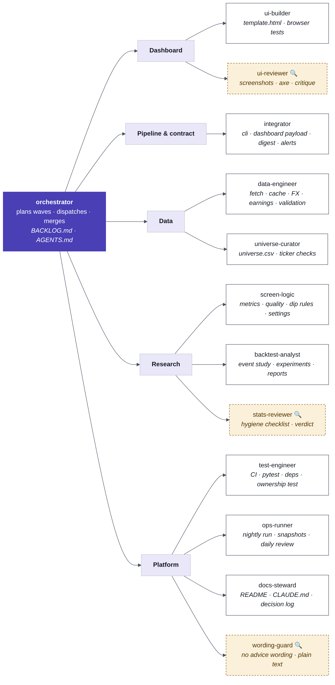
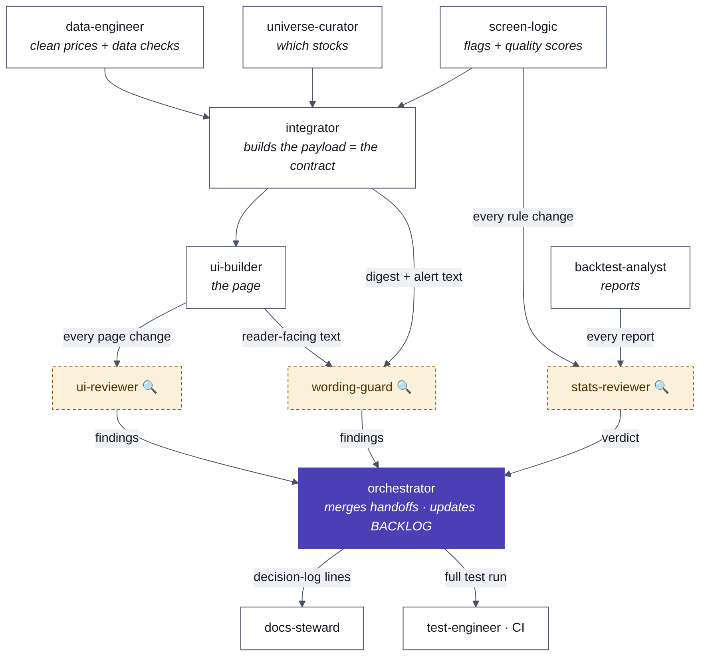

# Working on this repo with several agents

Current state, done work and next steps: docs/STATUS.md (read it first).

Thirteen agents, one owner per file, independent reviewers, and a backlog split into waves that can run at the same time.
Definitions live in `.claude/agents/*.md` (Claude Code loads them as subagents). File ownership lives in
`docs/agents/ownership.csv` and is enforced by `tests/test_ownership.py`. Open work is in `docs/BACKLOG.md`.

## The tree

| Branch | Agent | Edits | Reviewed by |
|---|---|---|---|
| Root | **orchestrator** | `docs/BACKLOG.md`, this file, `docs/agents/*`, `.claude/agents/*` | Iiro |
| Dashboard | **ui-builder** | `src/template.html`, `tests/test_browser.py`, `scripts/screenshots.py`, demo pages, the `dashboard-design` skill | ui-reviewer, wording-guard |
| Dashboard | ui-reviewer (read-only) | nothing | |
| Pipeline | **integrator** | `cli.py`, `dashboard.py` (the payload), `digest.py`, `alerts.py`, `demo.py`, `config.py`, small helpers, `docs/payload.md` | wording-guard for digest and alert text |
| Data | **data-engineer** | `data.py`, `openbb_source.py`, `cache.py`, `fx.py`, `earnings.py`, `validate.py`, `crosscheck.py`, `scripts/verify_sources.py` | |
| Data | **universe-curator** | `config/universe.csv`, `scripts/verify_universe.py` | |
| Research | **screen-logic** | `metrics.py`, `quality.py`, `screen.py`, `residual.py`, `config/settings.toml` | stats-reviewer |
| Research | **backtest-analyst** | `backtest*.py`, `feature_experiment.py`, `forecast.py`, the run scripts, reports, the `backtest-hygiene` skill | stats-reviewer |
| Research | stats-reviewer (read-only) | nothing | |
| Platform | **test-engineer** | shared test helpers, `pytest.ini`, `requirements*.txt`, `.github/`, `.gitignore`, `tests/test_ownership.py` | |
| Platform | **ops-runner** | `scripts/run_daily.bat`, `install_task.ps1`, `notify.ps1`, `snapshots/`, `/daily-review` | |
| Platform | **docs-steward** | `README.md`, `START_HERE.md`, `TESTING.md`, `CLAUDE.md` (with Iiro's approval), `docs/CLOUD.md`, `docs/PLAN.md`, `docs/decisions.md` | |
| Platform | wording-guard (read-only) | nothing | |

Each module's tests belong to the module's owner (for example `tests/test_screen.py` belongs to screen-logic).
The exact list is `docs/agents/ownership.csv`.

## How work flows

- **The payload is the contract.** data-engineer, universe-curator and screen-logic feed integrator. integrator builds the JSON
  payload and documents it in `docs/payload.md`. ui-builder only reads it. So the page and the back end can change in parallel,
  and only integrator may rename a payload field.
- **Nobody grades their own work.** Every page change goes to ui-reviewer. Every rule change, backtest or "this works" claim goes
  to stats-reviewer. Any text a reader sees goes to wording-guard.
- **The main session is the orchestrator.** It dispatches every agent itself, so the tree never depends on a subagent being able
  to start its own subagents.

## Running a wave

1. The orchestrator picks the next wave in `docs/BACKLOG.md`. Tasks in one wave never share a file in the "Locks" column.
2. It briefs each owner with the backlog id, goal, the files it may edit, the checks to run and the branch name. Example:
   > Use the `ui-builder` agent. Backlog FE-2. Goal: … You may edit only `src/template.html` and `tests/test_browser.py`.
   > Checks: browser tests, 4 screenshots, axe. Branch: `wave-2`. End with the handoff from your agent file.
3. When builders finish, their reviewers run.
4. The orchestrator merges the handoffs. It updates item status in the backlog, passes "requests to other owners" on, and hands
   decision-log lines to docs-steward. Then it runs the full test suite once and reports to Iiro.

## Handoff format (every agent ends with this)
1. **Done:** one line per changed file.
2. **Checked:** commands run, with the pytest summary line.
3. **Not checked:** what needs a live run, a reviewer or Iiro.
4. **Requests to other owners:** exact change, file, owner.
5. **Decision-log line:** one dated sentence, or "none".

## Rules that keep parallel work safe
- Edit only your own files. To change someone else's, put the exact change in your handoff.
- Adding a file? Add its pattern to `docs/agents/ownership.csv` in the same commit, or `tests/test_ownership.py` fails.
  Only the orchestrator edits that file, so ask for the change in your handoff if you are not the orchestrator.
- The hot group is `src/template.html` (later `src/web/`), `src/dipdash/dashboard.py` and `src/dipdash/cli.py`. Two tasks that
  touch it never run at the same time; a paired task (marked ① ② in the backlog) runs its parts in order.
- The build sandbox usually cannot reach Yahoo or OpenBB. Use `--demo`, the synthetic tests and `snapshots/`, and list
  what needs a live run on Iiro's Windows PC.
- Wording stays neutral everywhere: "screen results", "candidates", "flagged because". Never "buy", "sell" or "target".

## Changing the tree
Add or edit an agent in `.claude/agents/`, give it files in `docs/agents/ownership.csv`, add it to the table above, and
re-render the diagrams from `docs/agents/*.mmd` (`mmdc -i agent-tree.mmd -o agent-tree.png -w 1400 -b white -s 2`).
`pytest tests/test_ownership.py` checks names, front matter, one owner per file, and that reviewers have no edit tools.
