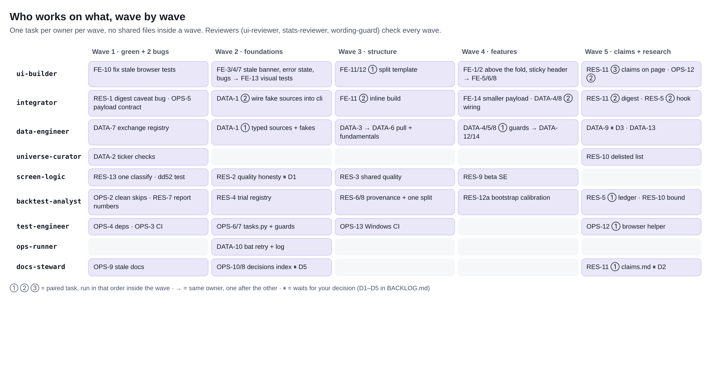

# Backlog

Built on 2026-11-04 from four read-only audits (front end, data pipeline, research, tests/docs). Owners and rules are in
`docs/AGENTS.md`. Each wave gives each owner at most one task, and no two tasks in a wave lock the same file. Tasks
marked **pair** cross an ownership line: the first owner builds, the second wires it in, in that order within the wave.

Status values: `todo`, `doing`, `review`, `done`, `blocked: <reason>`. Size: S < half a day, M about a day, L more.
IDs keep the audit prefix: FE front end, DATA data, RES research, OPS tests/docs/ops. Merged duplicates are noted.

State when written: `pytest` gives 8 failed, 399 passed. The failures are 3 stale browser tests, 4 tests needing `statsmodels`
(not listed in requirements) and 1 test needing `arch`. Wave 1 brings it to green.

## Wave 1: green suite, two real bugs, first contracts

| ID | Task | Owner | Locks | Size | Check | Status |
|---|---|---|---|---|---|---|
| FE-10 (= OPS-1) | Fix the 3 stale browser tests: derive counts from `DATA` instead of 60/18, open "+N more" before reading tile chips, add stable `data-testid` hooks | ui-builder | tests/test_browser.py, template.html (attributes only) | S | browser suite 18/18 green | done 2026-11-04 |
| RES-1 | **Bug:** the digest picks `2026-11-04_forecast/` instead of the backtest folder, so the standing "no out-of-sample edge" caveat disappears (seen in the 4 Nov snapshot digest). Select by spec type; always print a fixed caveat | integrator | digest.py, tests/test_digest.py | S | new test with sibling folders `X`, `X_features`, `X_forecast`; the caveat sentence is always present | done 2026-11-04 |
| OPS-5 (= FE-9, part 1) | Write `docs/payload.md` (every top-level and row field: type, unit, null meaning) and a contract test: the demo payload, through the CLI path including `alerts`, matches it, and every `DATA.x` the template reads exists | integrator | docs/payload.md, tests/test_payload_contract.py | S-M | the test fails when a planted field rename is made | done 2026-11-04 |
| OPS-2 + RES-7 | Tests skip cleanly without `statsmodels`/`arch`, with an explicit test of the EWMA fallback. Remove hand-typed numbers from the backtest report ("+0.2660%", "59 of 60", "about 660 lags") and derive them from the spec | backtest-analyst | tests/test_feature_experiment.py, tests/test_forecast.py, backtest_report.py | S | suite green with and without the extras; report test on a synthetic universe | done 2026-11-04 |
| OPS-4 (= DATA-11) + OPS-3 | Add `statsmodels` to requirements and split runtime from `requirements-dev.txt` (exact pins; yfinance pinned to the verified version). Add GitHub Actions CI: offline unit job on Python 3.11 and 3.13, plus a browser job with Chromium | test-engineer | requirements*.txt, .github/ | M | CI green on the branch | done 2026-11-04 (workflow written; no GitHub run seen yet) |
| DATA-2 (offline part) | `tests/test_universe.py` (known suffixes, region matches suffix, sector list, share-class format, no duplicate names) and `scripts/verify_universe.py` (needs network; writes `config/universe_verified.csv` with status per ticker: no bars, stale, not equity, name mismatch, currency, under 20B USD) | universe-curator | tests/test_universe.py, scripts/verify_universe.py | M | offline test green now; Iiro runs the script once on his PC | done 2026-11-04 (offline test and script; Iiro still runs the script once on his PC) |
| DATA-7 | One exchange registry (`exchanges.py`: tz, close time, currency, OpenBB provider, index) replacing 4 suffix tables. Fixes Lisbon earnings times being converted in New York time | data-engineer | exchanges.py, validate.py, earnings.py, openbb_source.py | S | old tables equal the derived views; every universe suffix is covered | done 2026-11-04 |
| RES-13 (part) + RES-12c | Merge `classify`/`classify_prev` into one function; test `dd52` with 60-251 bars | screen-logic | screen.py, metrics.py, tests/test_screen.py, tests/test_metrics.py | S | existing tests plus the new ones | done 2026-11-04 (shared `setup_label`; `classify_prev` kept as a wrapper; dd52 short-history test added) |
| OPS-9 + OPS-11 | Fix stale docs: "60 stocks", "about 390/270 tests", PLAN.md status and skills note. Say which demo page is canonical | docs-steward | README.md, TESTING.md, docs/PLAN.md, docs/CLOUD.md, docs/sample-output/README.md | S | a grep shows only intended hits | done 2026-11-04 |

Reviews: stats-reviewer on RES-1 and RES-7; wording-guard on the RES-1 caveat text; ui-reviewer on FE-10 if markup changes.

## Wave 2: foundations other work builds on

| ID | Task | Owner | Locks | Size | Check | Status |
|---|---|---|---|---|---|---|
| DATA-1 (**pair**, first) | Typed source contracts (`sources.py`: `Bars`, `PriceSource`, `FundamentalsSource`, `FxSource`, `IndexSource`) and `tests/fakes.py` (a fake Yahoo that can fail, lag or return NaN) | data-engineer | sources.py, tests/fakes.py, data.py, openbb_source.py, fx.py | M | fakes drive `pull_prices` and `fetch_indices` offline | done 2026-11-05 |
| DATA-1 (**pair**, second) | `cli.main(..., sources=)`; end-to-end offline test of the live branch: raw files, `data_quality.csv`, exit code 2 guard | integrator | cli.py, tests/test_pipeline_live.py | M | live branch tested offline for the first time | done 2026-11-05 |
| FE-3 + FE-4 + FE-7 | Stale-data banner ("data is from Fri 31 Oct; the nightly run may have failed"); visible error message plus `<noscript>` if drawing fails; small bugs (end dot always red, `.foot` unstyled in detail, brief claims to follow all filters, chart width on resize, currency on chart axis) | ui-builder | template.html | M | browser tests with an old payload and a broken row; 4 screenshots | done 2026-11-05 |
| FE-13 | Visual-regression screenshots: default, detail, filters, empty, stale, print states, with font routing and a pixel diff against baselines; `docs/frontend-contract.md` listing the DOM ids tests depend on | ui-builder (after FE-3) | scripts/screenshots.py, tests/visual/, docs/frontend-contract.md | M | a planted colour change is flagged | done 2026-11-05 (baselines are Linux only; first CI run may need them remade) |
| RES-4 | One pre-registration and trial registry (`registry.py`: register before computing, one trial schema, a ledger of periods already viewed); all three runners use it | backtest-analyst | registry.py, backtest_run.py, scripts/run_feature_experiment.py, scripts/run_forecast_calibration.py | M | a runner that computes before registering fails a test | done 2026-11-05 |
| RES-2 | Quality score honesty: show "scored on n/6"; add a `distorted` status (ROE above 100%, or ROE and D/E both missing with positive debt, which suggests negative equity); add a `must_pass` list in settings, empty until Iiro chooses | screen-logic | quality.py, config/settings.toml [quality], tests/test_quality.py | M | known-answer tests: negative equity cannot reach 100; label counts on the snapshot reported as descriptive only | done 2026-11-05: steps 1-3 done (D1 answered; `must_pass` default `net_margin_positive`); RES-11 page part done: neutral label, sort by size of drop, "Dips meeting the check thresholds" |
| OPS-6 + OPS-7 | `tasks.py` (stdlib, Windows and Linux): `demo`, `test`, `test-browser`, `shots`, `check`. Pre-commit guards: a wording scan (buy now, sell, price target, will recover) and a block on staged `data/`, `output/`, `.env` | test-engineer | tasks.py, .pre-commit-config.yaml, scripts/check_wording.py | S-M | `python tasks.py check` green; a planted "buy now" is rejected | done 2026-11-05 |
| OPS-10 + OPS-8 | Topic index for `docs/decisions.md` (or one file per decision) so parallel appends stop conflicting; a short "working in parallel" section in CLAUDE.md pointing to AGENTS.md | docs-steward | docs/decisions*, CLAUDE.md | M | every old entry present exactly once | done 2026-11-05 (D5 A approved 2026-11-04; Rule 4 is in CLAUDE.md) |
| DATA-10 | `run_daily.bat`: one retry 20 minutes after exit code 2; rotate `run.log` at about 5 MB | ops-runner | scripts/run_daily.bat | S | Windows only: Iiro runs it once | done 2026-11-05 (retry and rotation present in the .bat; Windows run still Iiro's) |

## Wave 3: structure that makes later changes cheap

| ID | Task | Owner | Locks | Size | Check | Status |
|---|---|---|---|---|---|---|
| FE-11 + FE-12 (**pair**, first) | Split `template.html` into `src/web/` (tokens, layout, components CSS; one JS file per section) that build into the same single self-contained file. Remove duplicate dark tokens, colliding class names and dead code | ui-builder | src/template.html, src/web/ | M | rendered DOM identical for the demo payload; visual diff clean; axe 0 | done 2026-11-05 (commit 0e838af). Page source is the `src/web/` parts; `src/template.html` is generated by `src/web/assemble.py` and committed. FE-12 cleanups: duplicate dark tokens removed, 2 redundant CSS rules merged, helpers moved. The two class-name clashes (`.more`, `.empty`) are being fixed now |
| FE-11 (**pair**, second) | `render_html` inlines `src/web/` parts, keeps one `__DATA__` and the `</` escape | integrator | dashboard.py (render_html only) | S | test_dashboard green | dropped 2026-11-05: not needed, because `template.html` is generated and committed, so `render_html` keeps reading it as before |
| DATA-3, then DATA-6 | Price pull in batches of about 60 with retry and backoff; re-fetch lagging tickers; OpenBB fallback in a small thread pool. Fundamentals fetch: retry, atomic cache, `stale` flag, refreshes spread over the week | data-engineer | data.py | M | fake tests: a failed batch is retried; a lagging .PA ticker is re-fetched; the cache is never half-written | done 2026-11-05 (5ac8ada: batched pulls, retry, lag re-fetch, threaded fallback, atomic fundamentals cache) |
| RES-6 + RES-8 | Provenance in every spec (code hash, package versions, settings hash per section, seeds from settings). One shared out-of-sample split and one dip-state function for all experiments | backtest-analyst | backtest_run.py, feature_experiment.py, the 3 run scripts | M | editing `[news]` no longer changes the backtest hash; all runners give the same cutoff | todo |
| RES-3 | Dashboard and backtest share one `score_universe`; sector rules move into settings so a change shows in the spec hash | screen-logic (after RES-2) | quality.py, settings.toml [quality] | S-M | V3 quality equals dashboard quality for the same inputs | todo |
| OPS-13 | Windows smoke job in CI: demo run through the `.bat` path and a PowerShell syntax check of `install_task.ps1` | test-engineer | .github/ | M | Windows job green | todo |

## Wave 4: page and data-quality features

| ID | Task | Owner | Locks | Size | Check | Status |
|---|---|---|---|---|---|---|
| FE-1 + FE-2 | Table above the fold (desktop filters on one row, compact phone tiles, shorter brief on phone); sticky table header; first 25 rows plus "Show all N"; skip building the hidden desktop table on phone (21,900 DOM nodes today) | ui-builder | src/web/ | M | first row under 900 px on desktop and under 844 px on phone; screenshots | done 2026-11-05 (5e7213d, 1a3ba93). Measured, demo page: DOM nodes desktop 1934 -> 1053, phone 2258 -> 647. The 21,900-node figure was not reproduced |
| FE-14 (**pair**) | Smaller payload: one shared date axis instead of 252 dates per stock (the page is 4 MB; 77% is chart history) | integrator, then ui-builder | dashboard.py, src/web/ chart | M | file size before and after; chart screenshots unchanged | done 2026-11-05 (18abec6). Measured, demo page: 4.10 -> 2.26 MB |
| DATA-4 + DATA-5 + DATA-8 | Guards: missing FX rate, a whole exchange missing, fundamentals coverage. Partial bars judged by each exchange's close time; "lagging" versus peers. A coverage table per exchange in the digest and `run_meta.json` | data-engineer (validate.py, coverage.py), integrator wires cli and digest (**pair**) | validate.py, coverage.py, then cli.py, digest.py | M | fake runs drop an FX rate or a suffix; Issues, banner and exit code asserted | done 2026-11-05: first half 51fb6f6 (guards, exchange-time partial bars, coverage table); second half 336b6cf, 056ed5b, 3ed2a50 (findings reach badge, digest and `data_quality.csv`; `run_meta.json`; stale-fundamentals warnings; run-health thresholds in settings) |
| DATA-12 + DATA-14 | Cross-check sample includes at least 1 Nordic name; reasons for every failed fetch; fix `verify_sources.py` crashes; index fetch with retry and naive dates | data-engineer (after DATA-4) | crosscheck.py, openbb_source.py, scripts/verify_sources.py, data.py index part | S | seeded sample tests | todo |
| RES-9 | Beta standard error; floored or uncertain betas labelled "not market-adjusted" instead of "5d resid."; one named "vs index" definition. Any shrinkage chosen by a pre-registered, return-free criterion | screen-logic, then integrator and ui-builder | residual.py, then dashboard.py, src/web/ detail | M | synthetic test: the SE covers the true beta about 95% of the time | todo |
| RES-12a | Calibrate the bootstrap and the placebo on null universes with a common factor (about 200 replicates, slow marker) | backtest-analyst | tests/test_backtest.py | M | false-positive rate near nominal | todo |
| FE-5 + FE-6 + FE-8 | Chart details by keyboard and touch (click a sector to filter); print stylesheet; filters kept in the URL; light/dark/auto toggle | ui-builder (after FE-1) | src/web/ | M | keyboard test; print PDF looked at; filters survive a reload | todo. FE-8 needs the forced-dark token rule re-added: the unused :root[data-theme=dark] copy was removed in the split (decision 2026-11-05) |

## Wave 5: honest claims and long-run research

| ID | Task | Owner | Locks | Size | Check | Status |
|---|---|---|---|---|---|---|
| RES-11 | A written claims contract (`docs/claims.md`): neutral setup labels such as "Dip, passes 4 of 5 scored checks"; default sort never by score; a generated "What testing found" box; more banned phrases ("likely", "rebound", "undervalued"). Then integrator (digest, alerts ranking) and ui-builder (page) apply it | docs-steward, then integrator and ui-builder | docs/claims.md, digest.py, alerts.py, src/web/ | M | tests assert the box matches the registry and the default sort is not by score | D2 decided B; page part done 2026-11-05; claims.md, digest and alerts parts open |
| RES-5 | Forward ledger: every night appends what was flagged (spec and universe hash); a script scores matured rows at 5/21/63 days. A true holdout without survivorship; needs years for power, stated plainly | backtest-analyst (ledger module, scorer), integrator (nightly hook) | ledger.py, scripts/score_ledger.py, then cli.py | M | append-only and idempotent tests; synthetic matured row | todo |
| RES-10 | Survivorship: `config/delisted.csv` where history can be found, plus a pre-registered stress bound (how much loser removal would cancel the estimate) | backtest-analyst, universe-curator | config/delisted.csv, scripts/run_backtest.py, backtest_report.py | L | spec lists the delisted names; bound matches a hand computation todo (unblocked: D4 A answered 2026-11-04) |
| DATA-9 | Raw-data retention script (dry run by default; archive, never delete without approval) | data-engineer | scripts/raw_retention.py | S-M | tmp_path test keeps the newest 60 days untouched | todo (unblocked: D3 A answered 2026-11-04) |
| DATA-13 | Earnings coverage for European names: per-exchange coverage report; optional manual overrides file, never used in a backtest | data-engineer | earnings.py, config/earnings_overrides.csv | S-M | override load, expiry and precedence tests | todo |
| OPS-12 | One shared browser helper for tests and screenshots; CI uploads the screenshot set | test-engineer, then ui-builder | tests/browser_util.py, then test_browser.py, screenshots.py | M | CI artifact has the PNGs | todo |

## Decisions needed from Iiro

- **D1 (RES-2):** which quality checks must pass, whatever the share. For example "net margin above 0". This is a definition, not a tested filter, because free fundamentals are not point-in-time. **Answered B 2026-11-04** (net margin above 0 must pass).
- **D2 (RES-11): decided B** (closed). Neutral label "Dip, passes n of m checks"; candidates not sorted by score by default.
- **D3 (DATA-9):** raw-data retention policy, for example keeping every pull for 60 days and then one per week, archived rather than deleted. **Answered A 2026-11-04** (60 days, then first pull of each week, archived, never deleted).
- **D4 (DATA-2):** what to do with tickers `verify_universe.py` flags (delisted, renamed, under 20B USD). Nothing is removed without your yes. **Answered A 2026-11-04** (flagged tickers are only listed).
- **D5 (OPS-8): closed.** Option A approved 2026-11-04; the section is Rule 4 in CLAUDE.md.

## Follow-ups after RES-2 (added 2026-11-05)

| ID | Task | Owner | Status |
|---|---|---|---|
| FU-1 | Regenerate stale samples: `docs/sample-output/digest_example_midsession_2026-11-02.md` (old headings, quality column, old caveat at line ~84), `snapshots/2026-11-04/latest/digest.md` and `daily_review_example_2026-11-02.md` | ops-runner | todo |
| FU-2 | Phone Filters summary says lowercase "quality ≥ N" at `template.html` ~640 and prose at ~625: use "quality score". Phone baselines must be remade | ui-builder | done 2026-11-05 |
| FU-3 | `docs/payload.md` lines ~76/89/90/180 reader-facing wording; enum values untouched | integrator | done 2026-11-05 (38b55e7) |
| FU-4 | `TESTING.md` ~line 63 still describes the old plain-share Intel 67 example; reword after confirming RES-2 behaviour | docs-steward | done 2026-11-05 (TESTING.md line 63 describes the current behaviour) |
| FU-5 | Optional: pass sector to V3 only if Iiro asks (decided 2026-11-05: keep disclosure only) | screen-logic / backtest-analyst | parked |
| FU-6 | `CLAUDE.md` line 1 and line 45 still say "quality-dip dashboard" / "quality score": needs Iiro's approval | docs-steward | blocked: Iiro approval |

## Not verified by the audits
Anything needing Yahoo or OpenBB (the sandbox is blocked), Windows behaviour, runtime for 348 tickers, and the ticker
hunches in DATA-2 (NSC, KDP, SOLB.BR, UNA.AS, DOW, HAL, EL, ADM).
