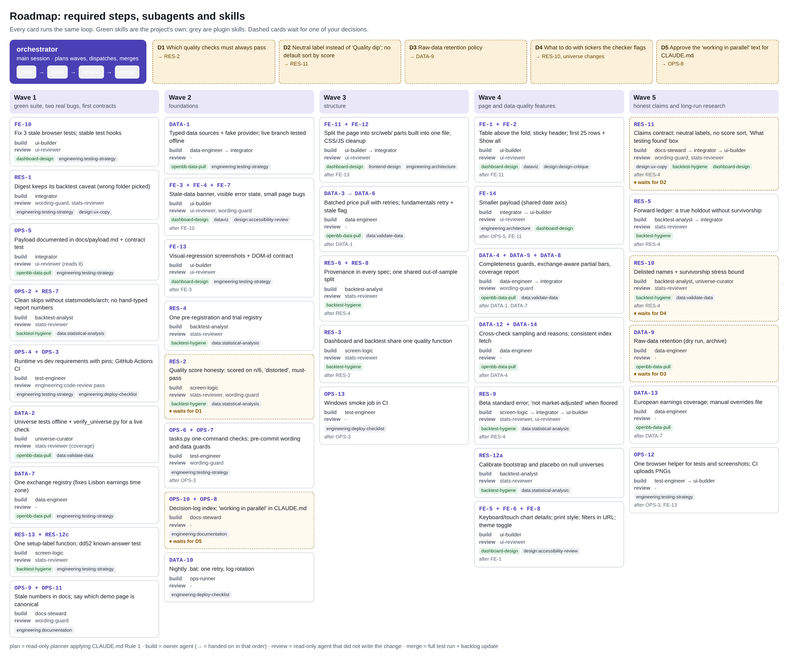

# Roadmap: every required step, who does it, with which skills

Generated from `docs/agents/roadmap_data.py` (edit there). Agents are defined in `.claude/agents/`; how a wave runs is in
`docs/AGENTS.md`; detail and status per item are in `docs/BACKLOG.md`. Wave-1 implementation plans are in `docs/plans/wave-1/`,
decision briefs in `docs/plans/decisions.md`. Later waves are planned when they start, so their plans match the code.

Every task follows the same loop: **plan** (a read-only planner applies CLAUDE.md Rule 1) → **build** (the owner agent) →
**review** (a read-only reviewer that did not write it) → **merge** (orchestrator, full test run, backlog update).

## Your decisions first

- **D1** Which quality checks must always pass → unblocks RES-2
- **D2** Neutral label instead of 'Quality dip'; no default sort by score → unblocks RES-11
- **D3** Raw-data retention policy → unblocks DATA-9
- **D4** What to do with tickers the checker flags → unblocks RES-10, universe changes
- **D5** Approve the 'working in parallel' text for CLAUDE.md → unblocks OPS-8

## Wave 1 · green suite, two real bugs, first contracts

- **FE-10**: Fix 3 stale browser tests; stable test hooks · plan: [`docs/plans/wave-1/FE-10.md`](plans/wave-1/FE-10.md)
  - builder: `ui-builder` · reviewer: ui-reviewer
  - skills: `dashboard-design`, `engineering:testing-strategy`
- **RES-1**: Digest keeps its backtest caveat (wrong folder picked) · plan: [`docs/plans/wave-1/RES-1.md`](plans/wave-1/RES-1.md)
  - builder: `integrator` · reviewer: wording-guard, stats-reviewer
  - skills: `engineering:testing-strategy`, `design:ux-copy`
- **OPS-5**: Payload documented in docs/payload.md + contract test · plan: [`docs/plans/wave-1/OPS-5.md`](plans/wave-1/OPS-5.md)
  - builder: `integrator` · reviewer: ui-reviewer (reads it)
  - skills: `openbb-data-pull`, `engineering:testing-strategy`
- **OPS-2 + RES-7**: Clean skips without statsmodels/arch; no hand-typed report numbers · plan: [`docs/plans/wave-1/OPS-2.md`](plans/wave-1/OPS-2.md)
  - builder: `backtest-analyst` · reviewer: stats-reviewer
  - skills: `backtest-hygiene`, `data:statistical-analysis`
- **OPS-4 + OPS-3**: Runtime vs dev requirements with pins; GitHub Actions CI · plan: [`docs/plans/wave-1/OPS-4.md`](plans/wave-1/OPS-4.md)
  - builder: `test-engineer` · reviewer: engineering:code-review pass
  - skills: `engineering:testing-strategy`, `engineering:deploy-checklist`
- **DATA-2**: Universe tests offline + verify_universe.py for a live check · plan: [`docs/plans/wave-1/DATA-2.md`](plans/wave-1/DATA-2.md)
  - builder: `universe-curator` · reviewer: stats-reviewer (coverage)
  - skills: `openbb-data-pull`, `data:validate-data`
- **DATA-7**: One exchange registry (fixes Lisbon earnings time zone) · plan: [`docs/plans/wave-1/DATA-7.md`](plans/wave-1/DATA-7.md)
  - builder: `data-engineer` · reviewer: -
  - skills: `openbb-data-pull`, `engineering:testing-strategy`
- **RES-13 + RES-12c**: One setup-label function; dd52 known-answer test · plan: [`docs/plans/wave-1/RES-13.md`](plans/wave-1/RES-13.md)
  - builder: `screen-logic` · reviewer: stats-reviewer
  - skills: `backtest-hygiene`, `engineering:testing-strategy`
- **OPS-9 + OPS-11**: Stale numbers in docs; say which demo page is canonical · plan: [`docs/plans/wave-1/OPS-9.md`](plans/wave-1/OPS-9.md)
  - builder: `docs-steward` · reviewer: wording-guard
  - skills: `engineering:documentation`

## Wave 2 · foundations

- **DATA-1**: Typed data sources + fake provider; live branch tested offline
  - builder: `data-engineer → integrator` · reviewer: -
  - skills: `openbb-data-pull`, `engineering:testing-strategy`
- **FE-3 + FE-4 + FE-7**: Stale-data banner, visible error state, small page bugs · after FE-10
  - builder: `ui-builder` · reviewer: ui-reviewer, wording-guard
  - skills: `dashboard-design`, `dataviz`, `design:accessibility-review`
- **FE-13**: Visual-regression screenshots + DOM-id contract · after FE-3
  - builder: `ui-builder` · reviewer: ui-reviewer
  - skills: `dashboard-design`, `engineering:testing-strategy`
- **RES-4**: One pre-registration and trial registry
  - builder: `backtest-analyst` · reviewer: stats-reviewer
  - skills: `backtest-hygiene`, `data:statistical-analysis`
- **RES-2**: Quality score honesty: scored on n/6, 'distorted', must-pass · waits for D1
  - builder: `screen-logic` · reviewer: stats-reviewer, wording-guard
  - skills: `backtest-hygiene`, `data:statistical-analysis`
- **OPS-6 + OPS-7**: tasks.py one-command checks; pre-commit wording and data guards · after OPS-3
  - builder: `test-engineer` · reviewer: wording-guard
  - skills: `engineering:testing-strategy`
- **OPS-10 + OPS-8**: Decision-log index; 'working in parallel' in CLAUDE.md · waits for D5
  - builder: `docs-steward` · reviewer: -
  - skills: `engineering:documentation`
- **DATA-10**: Nightly .bat: one retry, log rotation
  - builder: `ops-runner` · reviewer: -
  - skills: `engineering:deploy-checklist`

## Wave 3 · structure

- **FE-11 + FE-12**: Split the page into src/web/ parts built into one file; CSS/JS cleanup · after FE-13
  - builder: `ui-builder → integrator` · reviewer: ui-reviewer
  - skills: `dashboard-design`, `frontend-design`, `engineering:architecture`
- **DATA-3 → DATA-6**: Batched price pull with retries; fundamentals retry + stale flag · after DATA-1
  - builder: `data-engineer` · reviewer: -
  - skills: `openbb-data-pull`, `data:validate-data`
- **RES-6 + RES-8**: Provenance in every spec; one shared out-of-sample split · after RES-4
  - builder: `backtest-analyst` · reviewer: stats-reviewer
  - skills: `backtest-hygiene`
- **RES-3**: Dashboard and backtest share one quality function · after RES-2
  - builder: `screen-logic` · reviewer: stats-reviewer
  - skills: `backtest-hygiene`
- **OPS-13**: Windows smoke job in CI · after OPS-3
  - builder: `test-engineer` · reviewer: -
  - skills: `engineering:deploy-checklist`

## Wave 4 · page and data-quality features

- **FE-1 + FE-2**: Table above the fold; sticky header; first 25 rows + Show all · after FE-11
  - builder: `ui-builder` · reviewer: ui-reviewer
  - skills: `dashboard-design`, `dataviz`, `design:design-critique`
- **FE-14**: Smaller payload (shared date axis) · after OPS-5, FE-11
  - builder: `integrator → ui-builder` · reviewer: ui-reviewer
  - skills: `engineering:architecture`, `dashboard-design`
- **DATA-4 + DATA-5 + DATA-8**: Completeness guards, exchange-aware partial bars, coverage report · after DATA-1, DATA-7
  - builder: `data-engineer → integrator` · reviewer: wording-guard
  - skills: `openbb-data-pull`, `data:validate-data`
- **DATA-12 + DATA-14**: Cross-check sampling and reasons; consistent index fetch · after DATA-4
  - builder: `data-engineer` · reviewer: -
  - skills: `openbb-data-pull`
- **RES-9**: Beta standard error; 'not market-adjusted' when floored · after RES-4
  - builder: `screen-logic → integrator → ui-builder` · reviewer: stats-reviewer, ui-reviewer
  - skills: `backtest-hygiene`, `data:statistical-analysis`
- **RES-12a**: Calibrate bootstrap and placebo on null universes
  - builder: `backtest-analyst` · reviewer: stats-reviewer
  - skills: `backtest-hygiene`, `data:statistical-analysis`
- **FE-5 + FE-6 + FE-8**: Keyboard/touch chart details; print style; filters in URL; theme toggle · after FE-1
  - builder: `ui-builder` · reviewer: ui-reviewer
  - skills: `dashboard-design`, `design:accessibility-review`

## Wave 5 · honest claims and long-run research

- **RES-11**: Claims contract: neutral labels, no score sort, 'What testing found' box · after RES-4 · waits for D2
  - builder: `docs-steward → integrator → ui-builder` · reviewer: wording-guard, stats-reviewer
  - skills: `design:ux-copy`, `backtest-hygiene`, `dashboard-design`
- **RES-5**: Forward ledger: a true holdout without survivorship · after RES-4
  - builder: `backtest-analyst → integrator` · reviewer: stats-reviewer
  - skills: `backtest-hygiene`
- **RES-10**: Delisted names + survivorship stress bound · after RES-4 · waits for D4
  - builder: `backtest-analyst, universe-curator` · reviewer: stats-reviewer
  - skills: `backtest-hygiene`, `data:validate-data`
- **DATA-9**: Raw-data retention (dry run, archive) · waits for D3
  - builder: `data-engineer` · reviewer: -
  - skills: `openbb-data-pull`
- **DATA-13**: European earnings coverage; manual overrides file · after DATA-7
  - builder: `data-engineer` · reviewer: -
  - skills: `openbb-data-pull`
- **OPS-12**: One browser helper for tests and screenshots; CI uploads PNGs · after OPS-3, FE-13
  - builder: `test-engineer → ui-builder` · reviewer: -
  - skills: `engineering:testing-strategy`

## Skills used, and what each is for

- `dashboard-design`: project skill: layout, visual and verification rules for the page
- `openbb-data-pull`: project skill: provider checks, caching, validation
- `backtest-hygiene`: project skill: honest backtests (mandatory for any research claim)
- `dataviz`: chart form, colour and mark rules
- `frontend-design`: visual direction for UI
- `design:accessibility-review`: WCAG check
- `design:design-critique`: structured design feedback
- `design:ux-copy`: plain, neutral wording
- `data:validate-data`: QA of data and analyses
- `data:statistical-analysis`: statistical methods and uncertainty
- `engineering:testing-strategy`: what to test and how
- `engineering:architecture`: decision records and design trade-offs
- `engineering:documentation`: docs that match the code
- `engineering:deploy-checklist`: pre-release checks (CI, scheduled run)
- `engineering:code-review`: review of a diff before merge
