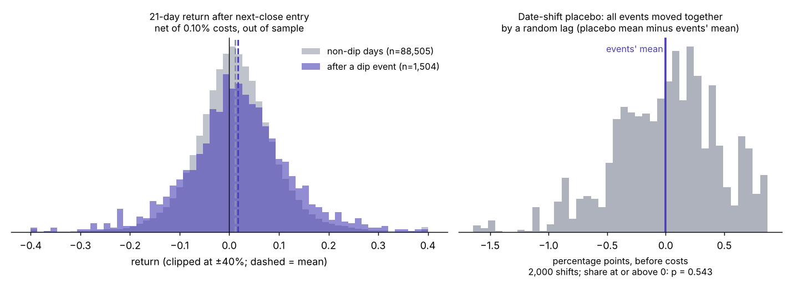
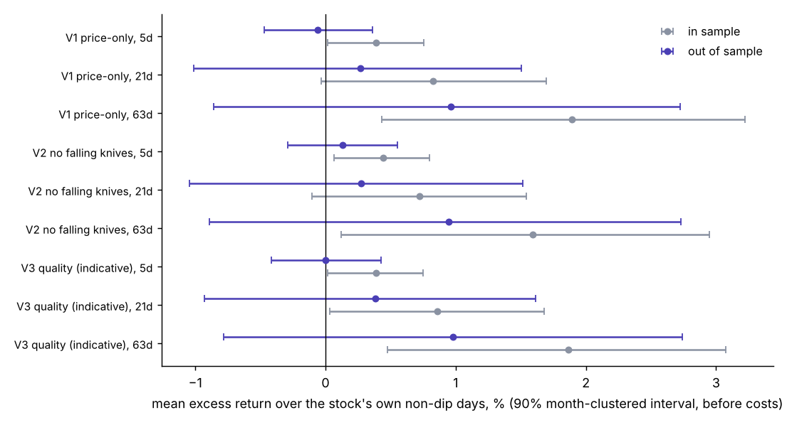

# Dip-rule event study

Run 2026-11-02 07:52 · spec `79288caaa97d33b1` · educational research, not investment advice. Everything below describes what happened historically, in this sample.

## Summary

- **Events:** 2,972 price-only dip events at the 21-day horizon after a 21-bar cooldown, on 59 stocks, 201 calendar months (2010-01-04 to 2026-10-30).
- **Universe:** 60 current blue chips (US, Europe, Nordic). Survivorship bias applies (see below).
- **Costs:** 0.10% round trip, also shown at 2× and 4×. Entry at the next close, no intraday fills.
- **Out-of-sample period:** after 2020-02-06 (the last 40% of trading dates); in-sample events whose window crosses that date are dropped.

### Pre-registered question

> For the price-only dip rule (V1), after the cooldown, the mean 21-trading-day forward return (entry at the next close), minus the same stock's mean 21-day return on its non-dip days in the same period, is greater than zero in the out-of-sample period (the last 40% of trading dates), all regions pooled, before costs. It counts as supported only if the 90% month-clustered bootstrap interval excludes zero. Every other cell in the report is descriptive.

**Result.** Out of sample, 1,504 events in 80 months averaged **+0.3%** over their own stocks' non-dip days at 21 days (90% interval −1.0% to +1.5%); the interval includes zero. In sample the same figure was +0.8% (−0.03% to +1.7%). Versus the regional index the figure was +0.6% (+0.1% to +1.1%); versus the other stocks the same day 0.0% (−0.4% to +0.4%). Share of date-shifted placebos (all events moved together by a random lag) at or above the events' mean: 0.54 (about 660 distinct lags, so read it to two decimals).

The pre-registered condition is not met: the interval includes zero, so this sample cannot separate the result from noise.

**In sample versus out of sample.** Across the 27 cells (3 variants × 3 horizons × 3 region groups), 14 in-sample intervals for the excess over each stock's own non-dip days exclude zero, against 0 of 27 out of sample (0 of 27 with market-stress days removed). The cells overlap, so this is a tally, not 27 independent tests. It does not show that the in-sample and out-of-sample results differ from each other: the out-of-sample intervals are about ±1.3 points wide at 21 days, so this sample has little power to detect an edge of the size seen in sample.

## Excess return over baselines, out of sample

| Variant | Horizon | Events | Excess vs own non-dip days | vs regional index | vs other stocks | Date-shift placebo p | Months |
|---|---|---|---|---|---|---|---|
| V1 price-only | 5d | 1,518 | −0.1% (−0.5% to +0.4%) | −0.1% (−0.3% to +0.1%) | −0.3% (−0.5% to +0.00%) | 0.76 | 81 |
| V1 price-only | 21d | 1,504 | +0.3% (−1.0% to +1.5%) | +0.6% (+0.1% to +1.1%) | 0.0% (−0.4% to +0.4%) | 0.54 | 80 |
| V1 price-only | 63d | 1,475 | +1.0% (−0.9% to +2.7%) | +1.9% (+1.1% to +2.8%) | +0.5% (−0.1% to +1.2%) | 0.40 | 78 |
| V2 no falling knives | 5d | 1,329 | +0.1% (−0.3% to +0.6%) | 0.0% (−0.2% to +0.3%) | −0.1% (−0.4% to +0.1%) | 0.39 | 81 |
| V2 no falling knives | 21d | 1,317 | +0.3% (−1.0% to +1.5%) | +0.7% (+0.2% to +1.2%) | +0.1% (−0.3% to +0.5%) | 0.51 | 80 |
| V2 no falling knives | 63d | 1,292 | +0.9% (−0.9% to +2.7%) | +1.9% (+1.0% to +2.8%) | +0.5% (−0.2% to +1.3%) | 0.50 | 78 |
| V3 quality (indicative) | 5d | 1,404 | 0.0% (−0.4% to +0.4%) | −0.1% (−0.3% to +0.2%) | −0.2% (−0.5% to +0.1%) | 0.66 | 81 |
| V3 quality (indicative) | 21d | 1,391 | +0.4% (−0.9% to +1.6%) | +0.7% (+0.2% to +1.2%) | +0.1% (−0.4% to +0.5%) | 0.40 | 80 |
| V3 quality (indicative) | 63d | 1,363 | +1.0% (−0.8% to +2.7%) | +1.8% (+1.0% to +2.6%) | +0.3% (−0.3% to +1.1%) | 0.41 | 78 |

Intervals are 90% bootstrap intervals that resample whole calendar months. V3 uses today's fundamentals on past dates, so it is indicative only. The index baseline is not currency-adjusted for stocks that do not trade in the index currency.

**Reading the index column.** It is not like-for-like: the stocks are dividend-adjusted and the indices are price-only, so it also carries roughly the dividend yield (not measured). On top of that, on ordinary (non-dip) days these same stocks beat their regional index by +0.4% over 21 days out of sample, because the universe is today's survivors. Read 'vs regional index' with both in mind; it is the weakest of the three baselines. 'vs own non-dip days' is the least distorted comparison, but survivorship can still bias even that one upward: dips that kept falling belong to companies that dropped out of the universe. The independent random-day placebo (kept in `results.csv`) gave 0.002 for the primary cell, but it ignores that events share dates and reads too optimistic, so it is not used.

## By horizon and region (V1, price-only)

| Horizon | Region | Period | Events | Excess (own) | 90% interval | Hit rate: events / non-dip days (net) | Median (net) | 10th pct | 90th pct | Worst |
|---|---|---|---|---|---|---|---|---|---|---|
| 5d | All | full sample | 2,986 | +0.2% | −0.1% to +0.4% | 54% / 54% | +0.4% | −5.4% | +6.2% | −34.4% |
| 5d | All | out of sample | 1,518 | −0.1% | −0.5% to +0.4% | 53% / 53% | +0.3% | −6.0% | +6.2% | −34.4% |
| 5d | US | full sample | 1,565 | +0.1% | −0.2% to +0.4% | 54% / 54% | +0.4% | −5.8% | +6.3% | −34.4% |
| 5d | US | out of sample | 826 | 0.0% | −0.4% to +0.5% | 53% / 53% | +0.2% | −6.0% | +6.5% | −34.4% |
| 5d | Europe + Nordic | full sample | 1,421 | +0.2% | −0.1% to +0.6% | 54% / 53% | +0.5% | −5.0% | +5.9% | −26.5% |
| 5d | Europe + Nordic | out of sample | 692 | −0.2% | −0.7% to +0.4% | 53% / 53% | +0.4% | −5.7% | +5.7% | −26.5% |
| 21d | All | full sample | 2,972 | +0.5% | −0.3% to +1.3% | 60% / 58% | +1.9% | −9.4% | +13.4% | −49.4% |
| 21d | All | out of sample | 1,504 | +0.3% | −1.0% to +1.5% | 58% / 56% | +1.7% | −11.0% | +14.2% | −49.4% |
| 21d | US | full sample | 1,556 | +0.2% | −0.6% to +1.0% | 60% / 59% | +1.8% | −9.7% | +14.1% | −49.4% |
| 21d | US | out of sample | 817 | 0.0% | −1.2% to +1.2% | 57% / 56% | +1.4% | −11.2% | +14.6% | −49.4% |
| 21d | Europe + Nordic | full sample | 1,416 | +0.8% | −0.1% to +1.7% | 60% / 57% | +2.0% | −8.8% | +12.6% | −40.8% |
| 21d | Europe + Nordic | out of sample | 687 | +0.5% | −1.0% to +2.1% | 58% / 56% | +2.0% | −10.6% | +13.7% | −40.8% |
| 63d | All | full sample | 2,943 | +1.5% | +0.4% to +2.6% | 66% / 64% | +5.7% | −12.5% | +25.6% | −64.2% |
| 63d | All | out of sample | 1,475 | +1.0% | −0.9% to +2.7% | 63% / 62% | +5.0% | −14.8% | +27.4% | −56.1% |
| 63d | US | full sample | 1,540 | +1.0% | −0.3% to +2.3% | 66% / 65% | +5.6% | −12.4% | +26.7% | −64.2% |
| 63d | US | out of sample | 801 | +0.5% | −1.5% to +2.5% | 64% / 62% | +4.6% | −14.8% | +28.1% | −56.1% |
| 63d | Europe + Nordic | full sample | 1,403 | +2.1% | +0.9% to +3.4% | 66% / 62% | +5.7% | −12.6% | +24.7% | −60.7% |
| 63d | Europe + Nordic | out of sample | 674 | +1.5% | −0.5% to +3.4% | 63% / 61% | +5.4% | −14.9% | +26.2% | −50.8% |

Hit rate, median and percentiles are net of costs, from entry to exit. A hit rate means little alone: the same stocks' ordinary windows also end higher most of the time. Worst = the single worst event. Events overlap in time at the longer horizons.

## After costs (V1, out of sample)

| Horizon | Mean gross | Net at 1× cost | Net at 2× cost | Net at 4× cost | Same stocks' average non-dip day | …as a yearly rate | Median worst dip after entry | Worst dip after entry |
|---|---|---|---|---|---|---|---|---|
| 5d | +0.3% | +0.2% | +0.1% | −0.1% | +0.4% | +20% | −1.7% | −34.3% |
| 21d | +1.8% | +1.7% | +1.6% | +1.4% | +1.5% | +20% | −4.1% | −57.3% |
| 63d | +6.1% | +6.0% | +5.9% | +5.7% | +5.1% | +22% | −7.0% | −57.3% |

The excess figures compare events with baselines before costs on both sides, because a trader who picked random days would pay the same round trip. 1× cost is 0.10%; spreads on less liquid names, taxes and currency conversion are not modelled. **The absolute returns in this table are inflated by survivorship**: these are today's large, successful companies, and their ordinary days already returned the rate shown in the last return column. Nobody could have picked this universe in advance, so the comparison with the same stocks' ordinary days is the least distorted one (survivorship still biases even that upward).

## Market-wide selloffs (V1, out of sample)

| Horizon | Events | n | Excess (own) | 90% interval | Mean net |
|---|---|---|---|---|---|
| 5d | all out-of-sample events | 1,518 | −0.1% | −0.5% to +0.4% | +0.2% |
| 5d | excluding days the regional index was 10%+ below its 60-day high | 1,248 | 0.0% | −0.5% to +0.4% | +0.2% |
| 21d | all out-of-sample events | 1,504 | +0.3% | −1.0% to +1.5% | +1.7% |
| 21d | excluding days the regional index was 10%+ below its 60-day high | 1,234 | −0.1% | −1.4% to +1.1% | +1.1% |
| 63d | all out-of-sample events | 1,475 | +1.0% | −0.9% to +2.7% | +6.0% |
| 63d | excluding days the regional index was 10%+ below its 60-day high | 1,205 | 0.0% | −1.8% to +1.7% | +4.8% |

Stress share of events: 19% overall, 21% in sample and 18% out of sample. Events cluster in market-wide selloffs, and the out-of-sample period contains no more of them than the in-sample period.

## Data checks

- 92 zero-volume bars in 25 tickers were removed before the run (0.034% of bars). Almost all are exchange-holiday placeholder rows with an unchanged price; one was a corrupt price (NOVO-B.CO, 2010-05-14: price doubled, volume 0).
- 59 price series validated after cleaning. Findings: large_move × 1, spike_revert × 1.
  - NFLX: +42.2% on 2013-01-24: check for a split or adjustment error (in sample).
  - KNEBV.HE: +29.6% on 2025-07-29 and back the next day, likely a bad price: thin volume (out of sample).
- 1 of 2,972 primary events touch a move of more than 40% in one day. They stay in the main numbers; the primary out-of-sample cell contains 0 of them.
- Prices are Yahoo's dividend-adjusted closes. They were cross-checked against exchange sources for sample tickers only (docs/m2-data-verification.md); long-history adjustments were not verified.

## How many things were tried

9 headline tests (3 variants × 3 horizons) were planned, and 108 cells were computed (adding 3 region groups and 4 periods), each with three baselines and a placebo. The report prints a subset; `results.csv` has all of them and `output/backtests/trials.csv` logs every one on every run (2 runs so far; several only reformatted the report). With this many looks, the best-looking cell is a candidate, not a finding.

## Changes after the first look

The first run of this study was computed with an earlier spec, and its output was read before the corrections below were made. The pre-registered question, the thresholds and the split were not changed, and the primary cell is identical in every run (+0.2660%, n = 1,504). The corrections were found by reading the first run's own numbers; they were not searched for in the other direction, and the independent review (next section) found one more problem that was left uncorrected.

- Run 1 (spec 90205cfc6da3a007) was a full run that included the out-of-sample primary cell, so the freeze is 'before the first run', not before anyone saw a number. Its spec file was overwritten by the next run (only the hash survives in trials.csv); specs are now archived by hash.
- Placebo: the independent same-stock same-year draw ignores that events share dates and gave p = 0.002 beside an interval that included zero. A date-shift placebo that moves all events by one common lag replaced it; the independent one stays in results.csv as 'placebo_*'. This lowered significance.
- Baseline and placebo days must have a computable signal (252 bars of history); before, a stock's first year counted as 'non-dip'. No predictable direction; the primary cell did not move.
- 92 zero-volume bars were removed before the run (91 exchange-holiday placeholders and one corrupt price). They were all in sample.
- Later runs with the same analysis (same numbers) only changed report charts and wording, so trials.csv shows several runs per spec.
- Found by the independent review and NOT acted on in the numbers: one more bad price (KNEBV.HE 2025-07-29) creates one false out-of-sample event; removing it moves the primary excess from +0.2660% to +0.2667%.

## Independent review

A separate reviewer that did not write the code recomputed the signals, cooldown events (5 tickers), 20 forward returns and the primary cell from the raw prices without using this code. It reported no look-ahead and no mismatch, and the same verdict (interval includes zero) under wider bootstrap blocks. Its other points are reflected in this report: the index column's dividend mismatch, that survivorship still biases the own-days comparison, one bad price the validators missed (KNEBV.HE 2025-07-29: +29.6%, then −24.1%, on low volume; it creates one false out-of-sample event and moves the primary excess from +0.2660% to +0.2667%, and a spike-and-revert check now flags such bars), and the in-sample interval's lower bound being −0.03%, not zero.

## How much to trust this

- **Survivorship bias.** The universe is today's blue chips. Companies that fell out of the indices, were delisted or were taken over are missing, and those are more likely to have kept falling after a dip. This flatters any dip-based rule, including the excess over a stock's own non-dip days. No result here has been discounted for it.
- **Events cluster.** Many events sit in the same selloffs, so the effective sample is far smaller than the event count. The intervals resample whole months for that reason; they still assume months are independent, and overlapping 21- and 63-day windows add more dependence.
- **Today's fundamentals in the past.** V3 filters past dips with the current quality score, which uses information that did not exist then. Treat V3 as indicative only; it is not shown to be better or worse than V1.
- **Thresholds were set before testing, but they are not proven.** They are the project's starting defaults; the report does not tune them. Changing them now and re-testing would create new trials.
- **Costs are simple.** One round-trip figure for all stocks and years. Real spreads, taxes, currency conversion and the cost of being unable to trade at the next close are not modelled.
- **Currency.** Returns are in each stock's own currency. The Europe + Nordic index baseline (STOXX 600, in EUR) is not currency-adjusted for CHF, SEK, DKK or NOK stocks.
- **Data.** One free source with adjusted prices back to 2010. Continental European lines were not independently verified (see the M2 notes), and clean data-quality counts above do not prove the prices are right.
- **One sample.** A single market history with a handful of large selloffs. A different history could give a different answer.
- **Low power.** Out-of-sample intervals are about ±1.3 points wide at 21 days, so an edge of a few tenths of a percent could not be detected either way. 'Not shown' is not 'absent'.
- **Coverage.** 59 of 60 stocks: ROG.SW (Roche) has no data at Yahoo. The exchange cross-check (M2) covered about three months of unadjusted closes for sample tickers; dividend adjustment and older history were not checked.
- **Simplifications.** Costs are one flat figure even though dip days usually have wider spreads (the 4× column partly covers that). The worst-dip-after-entry numbers use closes only, not intraday lows. A 21-bar cooldown means events are at least 22 bars apart.

## Files

`spec.json` (frozen before the run) · `results.csv` (every cell) · `events.csv` (every event with its returns) · `data_validation.csv` · `../trials.csv` (running log) · charts `distribution.png`, `forest.png`. Reproduce: `python scripts/run_backtest.py`.
